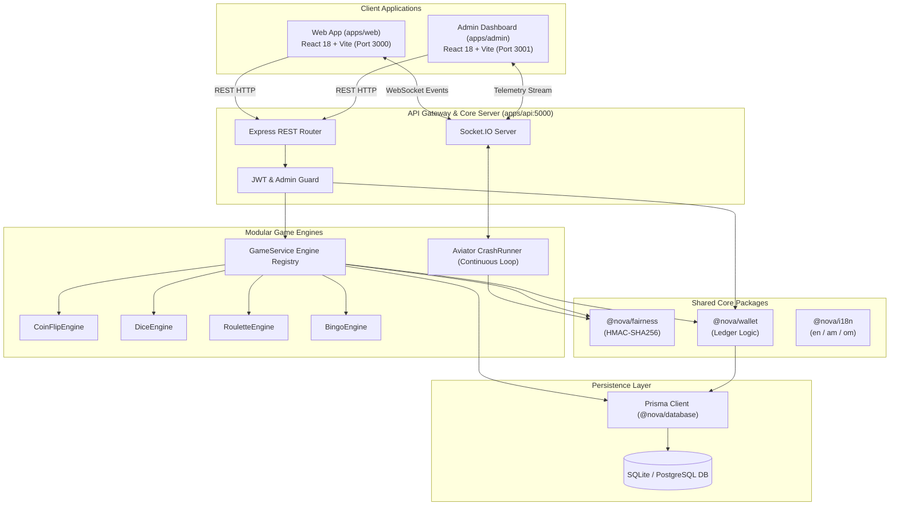
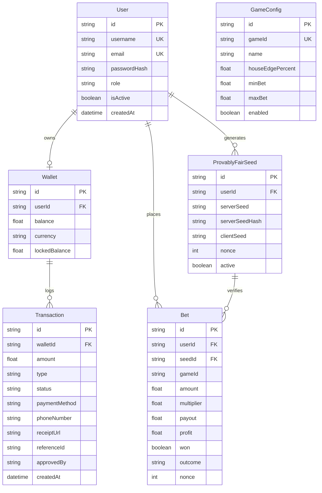

# 🎰 NOVA GAMING - Comprehensive Platform Documentation

## 1. Executive Summary & Architecture Philosophy

**NOVA Gaming** is a modular, high-concurrency multi-game platform monorepo engineered around a single core tenet:
> **Build the platform core once; plug in every game as an isolated, self-contained module.**

All gaming platform fundamentals—cryptographic provable fairness, double-entry wallet ledgering, fiat payment workflows (Telebirr & CBE Birr), authentication, multi-language internationalization (English, Amharic, Afaan Oromoo), administration, and real-time WebSocket state distribution—are centralized and shared. Each game (Crash/Aviator, Roulette, Coin Flip, Dice, Bingo, Mines) operates as a plug-in adhering to standardized base contracts.

---

## 2. Monorepo Topology

Managed using **Turborepo** and **pnpm workspaces**:

```text
nova-gaming/
├── apps/
│   ├── web/               # Player Web Application (React 18, Vite, Tailwind CSS, Port 3000)
│   ├── admin/             # Risk Control & Payment Approval Dashboard (Port 3001)
│   └── api/               # REST API & Socket.IO Engine Server (Express, TypeScript, Port 5000)
├── games/
│   ├── crash/             # Aviator Continuous Exponential Rocket Game Module
│   ├── limbo/             # Provably Fair Limbo Multiplier Challenge Game Module
│   ├── plinko/            # Provably Fair Plinko Pyramid Multiplier Game Module
│   ├── roulette/          # African Mini Roulette Wheel Game Module
│   ├── coin-flip/         # 3D Physics Coin Flip Game Module
│   ├── dice/              # Provably Fair High/Low Dice Game Module
│   ├── bingo/             # Automated Card & Ball Call Bingo Game Module
│   └── mines/             # Grid Minefield Game Module
├── packages/
│   ├── fairness/          # HMAC-SHA256 Cryptographic Provably Fair Engine
│   ├── database/          # Prisma ORM Schema & Client (SQLite/PostgreSQL compatible)
│   ├── wallet/            # Double-entry ledger logic & balance constraints
│   ├── game-engine/       # Abstract BaseGameEngine contracts & payout math
│   ├── auth/              # JWT issuance, password hashing & verification
│   ├── types/             # Shared TypeScript models, enums & interfaces
│   ├── ui/                # Shared Tailwind UI components (Button, Card, Input, Modal)
│   ├── i18n/              # Multi-lingual dictionaries (English, Amharic, Afaan Oromoo)
│   ├── validation/        # Zod validation schemas
│   ├── logger/            # Winston structured logger
│   └── config/            # Shared Tailwind & TypeScript presets
├── infrastructure/        # Docker Compose, Nginx Reverse Proxy, Postgres init
└── docs/                  # Architectural documentation & developer runbooks
```

---

## 3. System Architecture



---

## 4. Provably Fair Cryptographic Algorithm

Every game round mathematically guarantees platform integrity. Neither the casino nor the player can manipulate or predict the outcome once seeds are committed.

### Mathematical Specification
1. **Server Seed**: A cryptographically random 256-bit string generated server-side.
2. **Server Seed Hash**: Published to the player **before** any bet is accepted:
   $$\text{serverSeedHash} = \text{SHA-256}(\text{serverSeed})$$
3. **Client Seed**: Chosen or randomized by the player.
4. **Nonce**: Incremental integer tracking the total bets evaluated on the current seed pair.
5. **HMAC Signature**:
   $$\text{HMAC} = \text{HMAC-SHA256}(\text{key} = \text{serverSeed}, \text{data} = \text{clientSeed} : \text{nonce})$$
6. **Result Generation**:
   The first 8 hex characters (32 bits) of the HMAC are converted to an integer and mapped to the target game domain:
   $$\text{rawNumber} = \frac{\text{int}(\text{HMAC}[0..8])}{2^{32}}$$

### Game-Specific Conversions
- **Coin Flip**: $\text{rawNumber} < 0.5 \implies \text{HEADS}$, else $\text{TAILS}$.
- **Dice**: $\text{roll} = \lfloor \text{rawNumber} \times 10000 \rfloor / 100$.
- **Limbo Rocket**:
  $$\text{multiplier} = \max\left(1.00, \left\lfloor \frac{0.99}{1 - \text{rawNumber}} \times 100 \right\rfloor \div 100 \right)$$
  - Player selects target $T \ge 1.01\text{x}$.
  - Win condition: $\text{multiplier} \ge T$. Win chance $\approx \frac{0.99}{T}$. Payout $= T \times \text{amount}$.
- **Plinko Pyramid**:
  - The ball falls through $R \in [8..16]$ peg rows.
  - Path sequence: $R$ bounces, where each step $i$ is determined by byte $i$ of $\text{HMAC-SHA256}(\text{serverSeed}, \text{clientSeed}:\text{nonce})$:
    $$\text{byte}_i \ge 128 \implies \text{Right (R)}, \quad \text{else Left (L)}$$
  - Landing slot: $k = \sum [d_i = \text{'R'}] \in [0..R]$.
  - Multiplier curve: Binomial distribution with 1% house edge ($\text{RTP} = 99.0\%$).
- **Crash (Aviator)**:
  $$\text{crashPoint} = \max\left(1.00, \left\lfloor \frac{0.99}{1 - \text{rawNumber}} \times 100 \right\rfloor \div 100 \right)$$
  - Evaluated on a pre-committed, publicly verifiable SHA-256 hash chain ($H_{k-1} = \text{SHA256}(H_k)$).
- **Roulette**: African Mini Roulette $\text{pocket} = \lfloor \text{rawNumber} \times 13 \rfloor \in [0..12]$.

---

## 5. Aviator Crash Game Engine (Continuous Loop & Verifiable Fairness)

### Server-Authoritative Loop (`CrashRunner`)
The crash engine runs continuously on the API server:
1. **Betting / Countdown Phase (5 Seconds)**:
   - Server broadcasts `CRASH_STATE` with `state: 'BETTING'` and countdown timer ($5 \to 4 \to 3 \to 2 \to 1 \to \text{GO}$).
   - Outcome is pre-determined by the cryptographic hash chain link, which remains hidden until round resolution.
   - Players click **"PLACE BET"**; bets are validated, deducted from wallet, and registered in `activeBets`.
2. **Flight Phase**:
   - Multiplier accelerates exponentially according to:
     $$M(t) = e^{0.065 \cdot t}$$
   - Synchronized multiplier ticks (`CRASH_TICK`) broadcasted every 50ms.
   - Millisecond-accurate evaluation of automatic cashout thresholds.
   - Players can click **"CASH OUT"** in real time.
3. **Crash Phase**:
   - Rocket explodes at the pre-committed crash point (`CRASHED` state).
   - Revealed round hash is published to all clients for instant verification against the genesis anchor.
   - Any remaining active bets are marked as lost.
   - A 3-second recovery delay occurs before the next 5-second betting phase begins.

### Provably Fair Hash Chain & Safe Maintenance
- **Pre-Committed SHA-256 Hash Chain**: Rounds run along an immutable hash chain published upfront. Outcomes are cryptographically locked; neither players nor admins can predict or modify multipliers.
- **Safe Maintenance Pause & Automated Refunds**: Admins can safely pause the engine between flights (`pauseCrashEngine()`). Any uncashed bets in a cancelled flight are 100% refunded automatically via `CRASH_ROUND_REFUNDED`.

---

## 6. Wallet Ledger & Payment Verification System

### Currency Standardization: Integer Santim (100 Santim = 1 ETB)
To eliminate floating-point drift and rounding inaccuracies, all monetary columns in the database (`Wallet.balance`, `Wallet.lockedBalance`, `Transaction.amount`, `Transaction.balanceAfter`, `Bet.amount`, `Bet.payout`, `Bet.profit`) are stored strictly as **integers representing Ethiopian Santim**.

### Double-Entry Ledger & Concurrency Architecture
1. **Optimistic Concurrency Control (`version`)**:
   - Every balance mutation checks and increments `Wallet.version` inside an ACID `prisma.$transaction`.
   - Prevents race conditions such as concurrent double-spend or multiple cash-out attempts.
2. **Immutable Balance Snapshots (`balanceAfter`)**:
   - Every transaction row records the resulting balance snapshot immediately after execution.
3. **Idempotent Payment Verification (`referenceId`)**:
   - Database enforces a `@unique` constraint on payment references (`referenceId`).
   - Duplicate deposit submissions are detected and rejected immediately at the API boundary.
4. **Maker-Checker Security for High-Value Withdrawals**:
   - Automated threshold: withdrawals exceeding 5,000.00 ETB (500,000 Santim) require manual compliance review.
   - All administrative approvals and status changes are permanently logged to `AdminAuditLog`.
   - Clicking **"Reject"** voids the deposit request.

---

## 7. Database Entity Relationship Model



---

## 8. Internationalization (i18n)

The platform supports instantaneous runtime locale switching across:
- **English (`en`)**
- **Amharic (`am` - አማርኛ)**
- **Afaan Oromoo (`om`)**

Dictionaries are structured uniformly in `packages/i18n/src/translations/` covering navigation, games, wallet, error banners, and settings.

---

## 9. API & WebSocket Reference

### HTTP Endpoints (`/api/v1`)
| Route | Method | Description | Auth |
|---|---|---|---|
| `/auth/register` | `POST` | Create new player account | Public |
| `/auth/login` | `POST` | Authenticate player & obtain JWT | Public |
| `/auth/me` | `GET` | Current authenticated user profile | User |
| `/wallet` | `GET` | Retrieve wallet balance & status | User |
| `/wallet/deposit` | `POST` | Submit manual payment deposit request | User |
| `/wallet/transactions` | `GET` | Paginated transaction history | User |
| `/games/play/:gameId` | `POST` | Execute atomic game bet | User |
| `/games/provably-fair/seed` | `GET` | Retrieve active seed & hash | User |
| `/games/provably-fair/rotate`| `POST` | Rotate seeds & reveal previous seed | User |
| `/admin/stats` | `GET` | Total users, volume & platform bets | Admin |
| `/admin/deposits/pending` | `GET` | List pending manual payment requests | Admin |
| `/admin/deposits/:id/approve` | `POST` | Approve deposit & credit player | Admin |
| `/admin/deposits/:id/reject` | `POST` | Reject invalid deposit | Admin |
| `/admin/crash/monitor` | `GET` | Fetch real-time crash engine telemetry | Admin |
| `/admin/crash/set-point` | `POST` | Override upcoming crash point | Admin |
| `/admin/crash/emergency-crash` | `POST` | Trigger instant 1.00x crash | Admin |

### WebSocket Real-Time Events (`ws://localhost:5000`)
| Event Name | Direction | Payload Description |
|---|---|---|
| `CRASH_STATE` | Server $\to$ Client | Live game state (`roundId`, `state`, `countdown`, `history`) |
| `CRASH_TICK` | Server $\to$ Client | 50ms flight tick (`multiplier`, `state`) |
| `CRASH_PLACE_BET` | Client $\to$ Server | Register bet during betting phase (`userId`, `amount`, `autoCashoutMultiplier`) |
| `CRASH_MANUAL_CASHOUT` | Client $\to$ Server | Trigger cash out for active round |
| `CRASH_CASHOUT_SUCCESS` | Server $\to$ Client | Payout confirmation (`multiplier`, `payout`) |
| `ADMIN_CRASH_TELEMETRY` | Server $\to$ Admin | Pre-calculated crash point forecast, wagered totals & active counts |

---

## 10. How to Create a New Game Plug-in

Adding a new game to the platform requires only two steps:

### 1. Implement the Engine (`games/<game-name>`)
Extend `BaseGameEngine` from `@nova/game-engine`:
```typescript
import { BaseGameEngine, GameExecutionInput, GameExecutionOutput } from '@nova/game-engine';
import { ProvablyFair } from '@nova/fairness';

export class CustomGameEngine extends BaseGameEngine<MyParams, MyOutcome> {
  constructor() {
    super({
      gameId: 'custom-game',
      name: 'Custom Game',
      houseEdgePercent: 2.0,
      minBet: 1.0,
      maxBet: 5000.0,
    });
  }

  protected validateParams(params: MyParams) {
    return { valid: true };
  }

  evaluate(input: GameExecutionInput<MyParams>): GameExecutionOutput<MyOutcome> {
    const rawNumber = ProvablyFair.generateFloat(input.serverSeed, input.clientSeed, input.nonce);
    const won = rawNumber > 0.5;
    const multiplier = won ? 1.96 : 0;
    const { payout, profit } = this.calculatePayout(input.amount, multiplier);

    return {
      won,
      multiplier,
      payout,
      profit,
      outcome: { rawNumber },
    };
  }
}
```

### 2. Register the Engine in API & Routes
- Add instance to `GameService.engines` map in `apps/api/src/services/game.service.ts`.
- Add UI page under `apps/web/src/games/<game-name>/` and mount in `apps/web/src/routes/AppRoutes.tsx`.

---

## 11. Runbook & Commands

```bash
# Install all dependencies across all packages
pnpm install

# Build all 19 monorepo packages and apps
pnpm run build

# Start all development servers (Web: 3000, Admin: 3001, API: 5000)
pnpm run dev

# Sync database schema (Prisma)
npx prisma db push --schema=packages/database/prisma/schema.prisma

# Run Turbo linter and unit tests
pnpm run test
pnpm run lint
```

