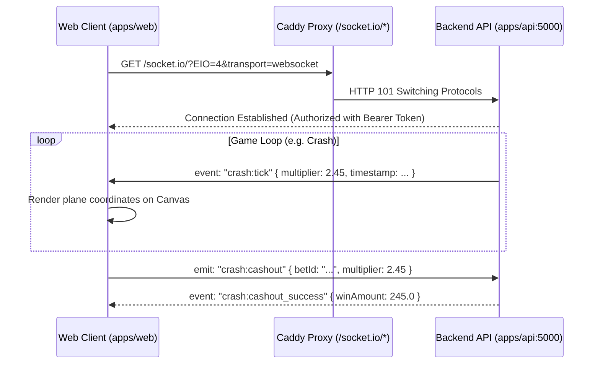

# 🌐 NOVA Gaming — Web Client Documentation (`@nova/web`)

## 1. Overview & System Role

The **NOVA Web Client** (`@nova/web`), located at [`apps/web`](file:///home/hope/NOVA-GAME/apps/web), is a high-concurrency, responsive, mobile-first Single Page Application (SPA) providing the complete player-facing interface and an integrated administrator control center for the NOVA Gaming platform.

### Core Technology Stack

| Layer | Technology | Purpose |
| :--- | :--- | :--- |
| **Framework** | **React 18.3** | Component lifecycle, hooks, and virtual DOM |
| **Language** | **TypeScript 5.4** | End-to-end type safety shared with monorepo packages |
| **Bundler & Dev Server** | **Vite 5.4** | Instant Hot Module Replacement (HMR) and optimized rollup production bundling |
| **State Management** | **Zustand 4.5** | High-performance, lightweight reactive state stores |
| **Client Routing** | **React Router DOM 6.22** | SPA declarative URL routing and deep linking |
| **Styling** | **Tailwind CSS 3.4** | Utility-first, mobile-responsive dark gaming design system |
| **Icons** | **Lucide React 0.368** | Modern, lightweight SVG iconography |
| **Real-time Networking** | **Socket.IO Client 4.7** | Low-latency bi-directional WebSocket streams |
| **HTTP Client** | **Axios 1.6** | REST API communication with Bearer token interceptors |
| **Validation** | **Zod 3.23** | Form validation and payload contract verification |

---

## 2. Directory Architecture & Source Layout

```text
apps/web/
├── public/                 # Static assets, game audio, icons, and favicon
├── src/
│   ├── components/         # Shared presentation & structural UI components
│   │   ├── common/         # Buttons, Badges, Modals, Spinners, Number formatters
│   │   └── layout/         # Layout wrappers, sticky Navbar, Sidebar, and MobileNav
│   ├── games/              # Dedicated game UI modules
│   │   ├── crash/          # Aviator Exponential Rocket / Red Plane Crash
│   │   ├── bingo/          # Ethiopian Cartella (75-Ball Bingo)
│   │   ├── dama/           # Ethiopian 8x8 Draughts (PvP & AI)
│   │   ├── roulette/       # European Mini Roulette Wheel
│   │   ├── coin-flip/      # 3D Physics Coin Flip
│   │   ├── dice/           # Provably Fair High/Low Slider Dice
│   │   ├── limbo/          # High-Multiplier Limbo Challenge
│   │   ├── plinko/         # Multi-row Pegboard Plinko Pyramid
│   │   ├── hilo/           # Hi-Lo Card Guessing
│   │   └── mines/          # Grid Minefield Cashout
│   ├── pages/              # Primary route view containers
│   │   ├── Home/           # Game Lobby, Hero Banner, Category filters, Recent Wins
│   │   ├── Wallet/         # Deposit (Telebirr, CBE Birr, Chapa), Receipt Upload, Withdraw
│   │   ├── Login/          # Player authentication
│   │   ├── Register/       # Player account creation
│   │   ├── History/        # Transparent bet log & cryptographic audit trail
│   │   ├── Settings/       # Provably fair seed rotation, language & sound settings
│   │   └── Admin/          # Administrative operations and risk control dashboard
│   ├── routes/             # Client route definitions (AppRoutes.tsx)
│   ├── services/           # Network clients & low-level communication
│   │   ├── api.ts          # Axios client with base URL resolution & auth headers
│   │   └── socket.ts       # Socket.IO client singleton with auto-reconnection
│   ├── stores/             # Global Zustand reactive stores
│   │   ├── authStore.ts    # User identity, JWT persistence & login/logout
│   │   ├── walletStore.ts  # Real-time balance, deposit & withdrawal actions
│   │   └── i18nStore.ts    # Multi-language translation dictionaries
│   ├── App.tsx             # Root React tree & global providers
│   ├── main.tsx            # DOM root mounting & bootstrap
│   └── index.css           # Global Tailwind directives & gaming scrollbar utilities
├── index.html              # HTML5 entrypoint with responsive viewport meta
├── package.json            # Dependencies and npm script targets
├── tsconfig.json           # TypeScript configuration with monorepo path aliases
└── vite.config.ts          # Vite build options, proxy settings, and port configuration
```

---

## 3. Client-Side Routes & Navigation Table

All routes are declared in [`apps/web/src/routes/AppRoutes.tsx`](file:///home/hope/NOVA-GAME/apps/web/src/routes/AppRoutes.tsx):

| URL Path | Component | Layout Wrapper | Access Level | Description |
| :--- | :--- | :--- | :--- | :--- |
| `/` | `HomePage` | Yes (`<Layout />`) | Public | Main Game Lobby, hero banner, category filters, and live recent wins ticker. |
| `/login` | `LoginPage` | Yes (`<Layout />`) | Public | Player sign-in screen with email/password validation. |
| `/register` | `RegisterPage` | Yes (`<Layout />`) | Public | Player registration with automatic demo balance allocation. |
| `/wallet` | `WalletPage` | Yes (`<Layout />`) | Authenticated / Guest | Deposit via Telebirr/CBE Birr with receipt image upload, withdrawal form, and ledger balance. |
| `/history` | `HistoryPage` | Yes (`<Layout />`) | Authenticated / Guest | Historical wagers, multipliers, payouts, and HMAC-SHA256 verification modal. |
| `/settings` | `SettingsPage` | Yes (`<Layout />`) | Public | Provably fair client seed rotation, language selection, and audio options. |
| `/games/crash` | `CrashPage` | Yes (`<Layout />`) | Public | Aviator Crash game with live multiplier chart, dual bet panels, and cashout. |
| `/games/bingo` | `BingoPage` | Yes (`<Layout />`) | Public | Ethiopian Cartella 75-Ball Bingo with single-mobile responsive card daubing. |
| `/games/dama` | `DamaPage` | Yes (`<Layout />`) | Public | Ethiopian 8x8 Dama on dark squares with PvP multiplayer and local AI mode. |
| `/games/roulette` | `RoulettePage` | Yes (`<Layout />`) | Public | European Mini Roulette with animated wheel and betting grid. |
| `/games/coin-flip`| `CoinFlipPage` | Yes (`<Layout />`) | Public | 3D physics-based Coin Flip. |
| `/games/dice` | `DicePage` | Yes (`<Layout />`) | Public | High/Low Slider Dice with provably fair verification. |
| `/games/limbo` | `LimboPage` | Yes (`<Layout />`) | Public | Instant Limbo multiplier challenge. |
| `/games/plinko` | `PlinkoPage` | Yes (`<Layout />`) | Public | Multi-row Plinko pyramid peg drop. |
| `/games/hilo` | `HiLoPage` | Yes (`<Layout />`) | Public | Card deck higher/lower guessing game. |
| `/admin` | `AdminPage` | Standalone Fullscreen | `ADMIN` Role Protected | Operations dashboard: deposit approvals, Aviator safe-pause, Dama flags, Bingo config, and user management. |
| `*` | `<Navigate to="/" />` | — | Fallback | Unmatched routes automatically redirect to `/`. |

---

## 4. State Management (Zustand Stores)

### 4.1 Authentication Store (`authStore.ts`)
Manages player identity, JWT persistence in `localStorage`, and initial hydration:
- **State**:
  - `user`: Authenticated user profile (`id`, `username`, `email`, `role`).
  - `token`: Active JWT Bearer token stored in `localStorage['nova_token']`.
  - `isAuthenticated`: Boolean status flag.
- **Methods**:
  - `login(email, password)`: Authenticates against `/api/v1/auth/login`, saves token, and syncs wallet.
  - `register(username, email, password)`: Registers new player and logs in.
  - `logout()`: Clears token, resets to default guest state (1,000 ETB demo balance).
  - `fetchMe()`: Validates current token against `/api/v1/auth/me`.

### 4.2 Wallet Store (`walletStore.ts`)
Manages player balance and fiat payment workflows:
- **State**:
  - `balance`: Real-time account balance in ETB.
  - `currency`: Default `'ETB'`.
- **Methods**:
  - `fetchWallet()`: Fetches current balance from `/api/v1/wallet`.
  - `updateBalance(newBalance)`: Optimistically or reactively updates balance.
  - `deposit(amount, method, phone, receiptPhoto, refId)`: Submits pending deposit with receipt image to `/api/v1/wallet/deposit`.
  - `withdraw(amount, address)`: Submits withdrawal request to `/api/v1/wallet/withdraw`.

### 4.3 Internationalization Store (`i18nStore.ts`)
Controls multilingual localization across the interface:
- **Supported Languages**:
  - English (`en`)
  - Amharic (`am`) — አማርኛ
  - Afaan Oromoo (`om`)
- **Persistence**: Saved in `localStorage['nova_lang']`.
- **Usage**:
  ```tsx
  import { useI18nStore } from '../../stores/i18nStore';
  const t = useI18nStore((s) => s.t);
  return <span>{t.common.gameLobby}</span>;
  ```

---

## 5. Game Modules Overview

### 5.1 Aviator Crash (`src/games/crash/`)
- **Visuals**: Features a sleek red racing aircraft with cockpit pilot silhouette, spinning propeller disc, exhaust flame, and glowing trajectory trail.
- **Flight Path**: Exponential Bezier flight curve moving from bottom-left to top-right across a customized HTML5 Canvas.
- **Dual Betting Console**: Allows players to run two independent bets concurrently with distinct auto-cashout targets.
- **State Machine**:
  - `WAITING` / `COUNTDOWN`: Next round starting in $N$ seconds.
  - `FLYING`: Real-time multiplier climbs; `CASHOUT` buttons active.
  - `CRASHED`: Multiplier freezes; displays `PLANE CRASHED! [Multiplier]x`; winnings are preserved for players who cashed out prior to crash.
- **WebSocket Events**: Subscribes to `crash:tick`, `crash:crashed`, `crash:countdown`, and emits `crash:bet`, `crash:cashout`.

### 5.2 Ethiopian Cartella Bingo (`src/games/bingo/`)
- **Mobile-First Responsive Layout**: Specially designed for single-screen mobile gameplay with no horizontal scrolling or clipped cards.
- **Ball Calling System**: Interactive rolling ball caller with sound effects and historical call queue.
- **Patterns**: Dropdown pattern selector supporting:
  - 1 Line (Horizontal, Vertical, Diagonal)
  - 2 Lines
  - Four Corners
  - Top-Middle-Bottom Layer Cake
  - Clock & Arrow
  - Pyramid & Square
  - Full House (all 25 spaces)
- **Daubing**: Manual daubing with auto-check validation before prize claims.

### 5.3 Ethiopian Dama (`src/games/dama/`)
- **Authentic Rules Engine**: 8x8 board on dark squares adhering to traditional Ethiopian draughts rules:
  - Compulsory captures (quiet moves rejected if a capture exists).
  - Majority rule (longest capture path required).
  - Flying kings with multi-square sliding landing options.
- **Dual Play Modes**:
  - **PvP Online**: Matchmaking lobby, stake locking, move clock timers, reconnect recovery.
  - **Single Player vs AI**: Minimax evaluation with progressive depth.
- **Audio Feedback**: Distinct acoustic board effects for quiet moves, single captures, multi-jumps, king promotions, and game victories.

---

## 6. Real-Time WebSocket Architecture (`socket.ts`)

WebSockets are handled via a shared singleton [`apps/web/src/services/socket.ts`](file:///home/hope/NOVA-GAME/apps/web/src/services/socket.ts):



- **URL Resolution**: Uses `VITE_SOCKET_URL` $\rightarrow$ `VITE_WS_URL` $\rightarrow$ `http://localhost:5000` (in dev) $\rightarrow$ `window.location.origin` (in production).
- **Resilience**: Configured with 20 reconnection attempts, exponential backoff (1s to 5s), and automatic token re-attachment upon reconnection.

---

## 7. HTTP API Client (`api.ts`)

Axios is configured as a central client in [`apps/web/src/services/api.ts`](file:///home/hope/NOVA-GAME/apps/web/src/services/api.ts):
- **Base URL**: Defaults to `http://localhost:5000/api/v1` in dev, `VITE_API_URL` when provided, or `/api/v1` in production.
- **Request Interceptor**: Automatically attaches `Authorization: Bearer <nova_token>` to all outbound requests.
- **Timeout**: 10,000 ms default request limit.

---

## 8. Styling & UI Design System

- **Colors**:
  - Background: `bg-slate-950` / `bg-slate-900`
  - Brand Accent: `text-amber-400` / `bg-amber-500` (Gold / Amber theme)
  - Success & Balance: `text-emerald-400` / `bg-emerald-500`
  - Highlighting & Actions: `text-cyan-400` / `bg-cyan-500`
  - Danger & Crashes: `text-rose-500` / `bg-rose-500`
- **Responsive Breakpoints**:
  - `< 640px` (`sm`): Compact mobile view with bottom navigation bar.
  - `640px – 1024px` (`md`): Tablet layout with collapsible menus.
  - `> 1024px` (`lg`): Desktop layout with permanent sidebar and expanded game charts.

---

## 9. Development & Build Commands

All commands are run from the monorepo root or inside [`apps/web`](file:///home/hope/NOVA-GAME/apps/web):

```bash
# 1. Start local development server (Port 3000)
pnpm --filter @nova/web dev

# 2. Typecheck with TypeScript
pnpm --filter @nova/web exec tsc --noEmit

# 3. Production build (Outputs to apps/web/dist)
pnpm --filter @nova/web build

# 4. Preview production build locally
pnpm --filter @nova/web preview
```

### Environment Variables (`apps/web/.env.example`)

```env
# Production backend API base URL
VITE_API_URL=https://novagame.et/api/v1

# Production WebSocket endpoint
VITE_SOCKET_URL=https://novagame.et
```

---

## 10. Production Deployment

In production Docker Compose ([`docker-compose.prod.yml`](file:///home/hope/NOVA-GAME/docker-compose.prod.yml)):
1. `web_builder` uses [`infrastructure/docker/Dockerfile.web`](file:///home/hope/NOVA-GAME/infrastructure/docker/Dockerfile.web) to build the static bundle.
2. The compiled assets in `dist/` are copied to the `web_dist` volume.
3. [Caddy](file:///home/hope/NOVA-GAME/infrastructure/caddy/Caddyfile) serves `/assets/*` with 1-year immutable caching, applies Brotli/Zstandard/Gzip compression, and serves `index.html` with `no-cache` for instant zero-downtime updates.
